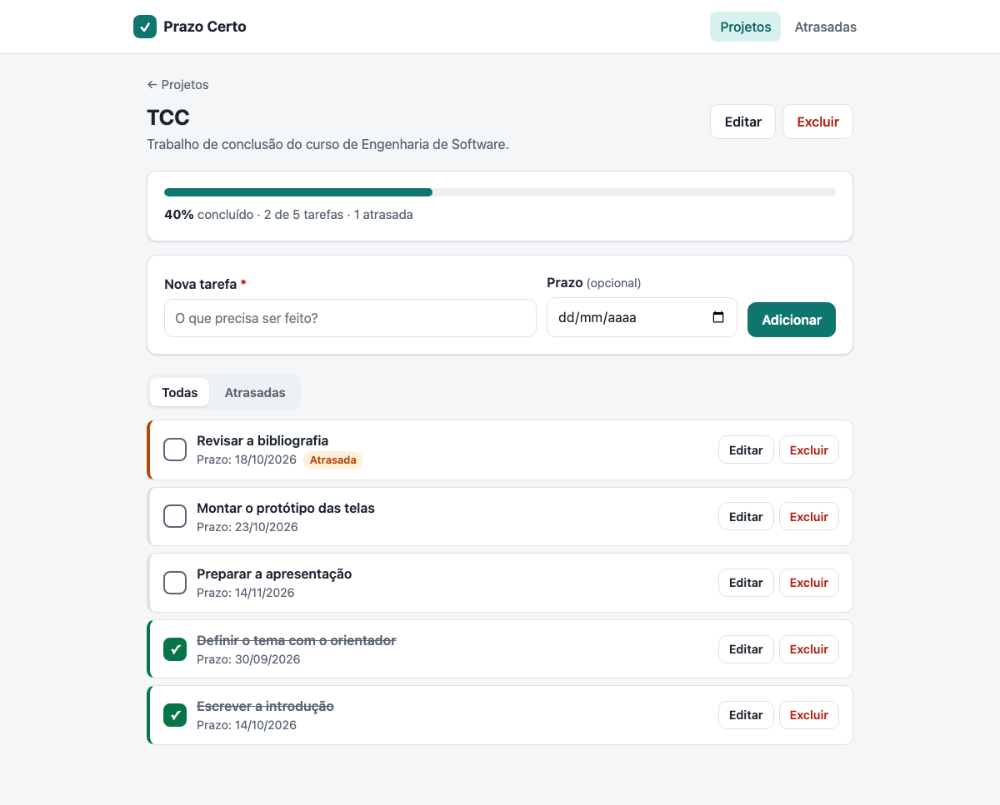

# Prazo Certo — Gerenciador de Tarefas por Projeto

Projeto da disciplina **Projeto Integrador Transdisciplinar em Engenharia de Software II**.

**🌐 Sistema no ar: https://prazo-certo-pit.vercel.app**

Sistema web em que o usuário cadastra projetos, cadastra tarefas dentro de cada projeto,
marca tarefas como concluídas e acompanha o progresso e os atrasos.

## Stack
- Python + Flask (arquitetura MVC)
- Templates HTML renderizados pelo back-end, CSS e JavaScript puro
- SQLite em desenvolvimento (PostgreSQL ou MySQL configurável por variável de ambiente)
- pytest para os testes automatizados

## Estrutura
| Pasta | Conteúdo |
|---|---|
| `situacao1/` | Documentação: escopo, diagramas, modelo de dados, dicionário de dados, protótipo |
| `situacao2/` | Código-fonte: app (models, controllers, templates, static), testes, requirements e manual |
| `situacao3/` | Testes com colegas, laudo de qualidade e roteiro do vídeo |

## Começo rápido
```bash
cd situacao2
python3 -m venv .venv && source .venv/bin/activate
pip install -r requirements.txt
cp .env.example .env
flask --app run popular-exemplo   # opcional: dados de exemplo
flask --app run run               # abre em http://127.0.0.1:5000
pytest                            # roda os 108 testes
```

Instalação detalhada, configuração do banco e **manual de uso** em [`situacao2/README.md`](situacao2/README.md).

## Funcionalidades
- Cadastrar, listar, editar e excluir projetos (nome obrigatório, descrição opcional)
- Cadastrar, listar, editar e excluir tarefas em cada projeto (título obrigatório, prazo opcional)
- Marcar e desmarcar tarefa como concluída, sem recarregar a página
- Progresso de cada projeto (concluídas ÷ total, em %)
- Filtro de tarefas atrasadas por projeto e página com as atrasadas de todos os projetos
- Excluir um projeto exclui as suas tarefas
- Mensagens claras de sucesso e de erro, sem expor erro técnico
- Layout para celular e modo escuro automático
- Formulário de avaliação para os colegas testarem o sistema (Situação 3): `/avaliacao`


