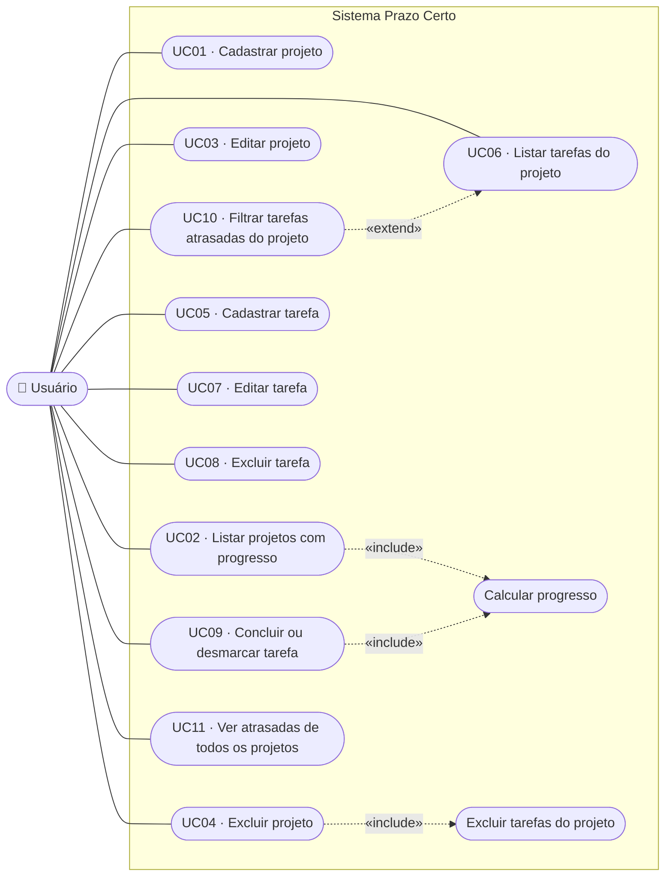
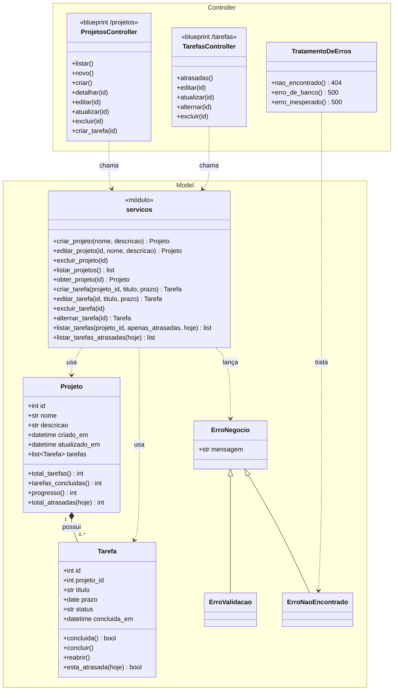
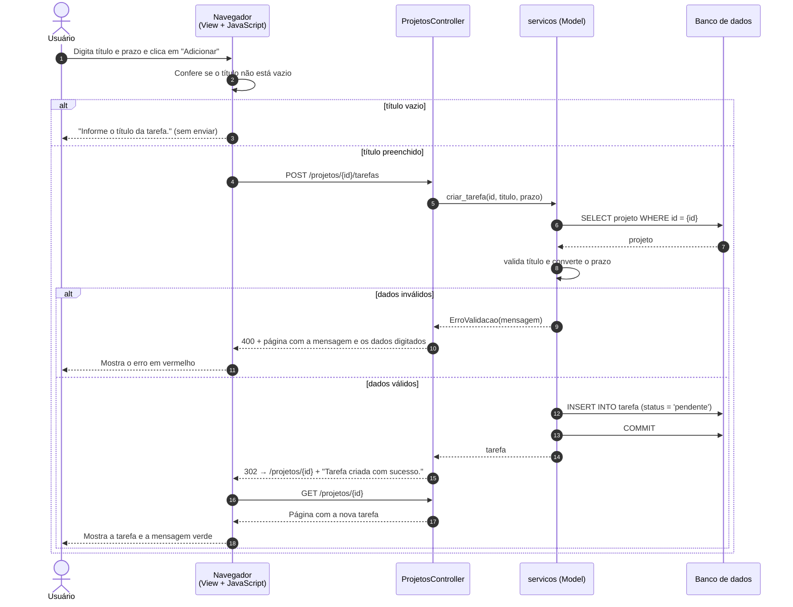
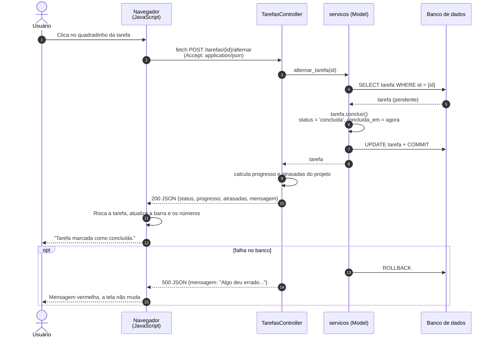
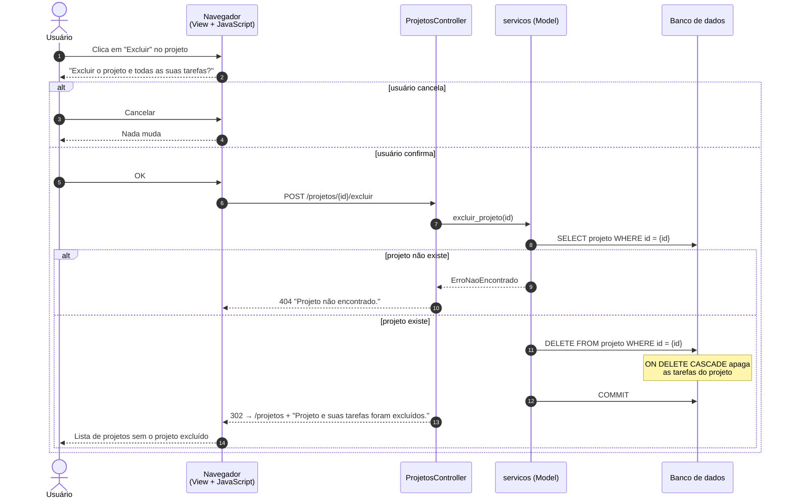
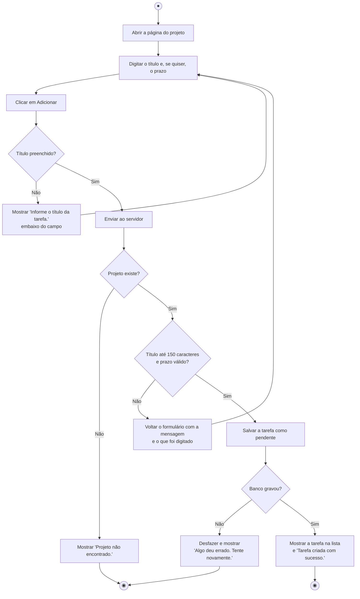
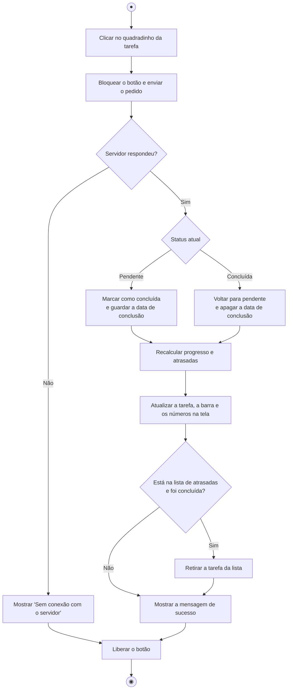
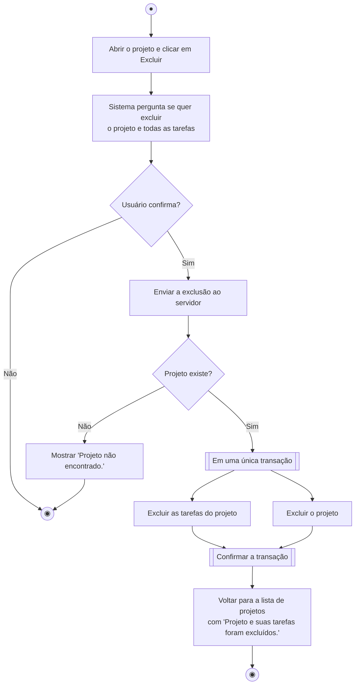
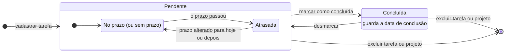
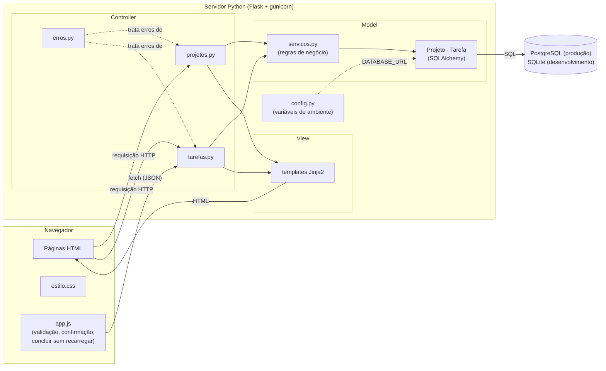

# Diagramas UML — Prazo Certo

Diagramas do sistema como ele foi implementado. Os desenhos estão em Mermaid (o GitHub mostra
direto nesta página), e as imagens PNG ficam em [`diagramas/`](diagramas/) para colar no documento de entrega.

| # | Diagrama | O que mostra |
|---|---|---|
| 1 | [Casos de uso](#1-diagrama-de-casos-de-uso) | O que o usuário pode fazer no sistema |
| 2 | [Classes](#2-diagrama-de-classes) | Classes do sistema em camadas MVC |
| 3 | [Sequência](#3-diagramas-de-sequência) | A troca de mensagens entre as camadas em 3 operações |
| 4 | [Atividades](#4-diagramas-de-atividades) | O passo a passo de 3 fluxos, com as decisões |
| 5 | [Estados](#5-diagrama-de-estados-da-tarefa) | Os estados por que passa uma tarefa |
| 6 | [Componentes](#6-diagrama-de-componentes-arquitetura-mvc) | Como as partes do sistema se ligam |

O diagrama de classes de persistência e o DER estão em [modelo-de-dados.md](modelo-de-dados.md).

---

## 1. Diagrama de casos de uso

**Ator:** Usuário, a pessoa que organiza os próprios projetos e tarefas. O sistema tem um único tipo de usuário.

> Observação: o Mermaid não tem um tipo próprio para casos de uso. As elipses são os casos de uso, as linhas
> contínuas ligam o ator, e as setas tracejadas são as relações «include» e «extend».

### Rastreabilidade: requisitos × casos de uso

| Requisito funcional | Casos de uso |
|---|---|
| RF1 — Cadastrar, listar, editar e excluir projetos | UC01, UC02, UC03, UC04 |
| RF2 — Cadastrar, listar, editar e excluir tarefas | UC05, UC06, UC07, UC08 |
| RF3 — Marcar e desmarcar tarefa como concluída | UC09 |
| RF4 — Mostrar o progresso de cada projeto | UC02, UC09 (Calcular progresso) |
| RF5 — Filtrar tarefas atrasadas | UC10, UC11 |
| RF6 — Excluir projeto exclui as tarefas | UC04 (Excluir tarefas do projeto) |
| RF7 — Mensagens claras de erro e confirmação | Todos (fluxos alternativos abaixo) |

### Descrição dos casos de uso

**UC01 — Cadastrar projeto**
- **Pré-condição:** nenhuma.
- **Fluxo principal:** 1. O usuário clica em "Novo projeto". 2. Informa o nome e, se quiser, a descrição. 3. Clica em "Criar projeto". 4. O sistema valida, salva e abre a página do projeto com "Projeto criado com sucesso."
- **Fluxos alternativos:** 4a. Nome vazio → "Informe o nome do projeto." · 4b. Nome já usado → "Já existe um projeto com esse nome." · 4c. Texto acima do limite → mensagem com o limite. Em todos, o formulário volta com o que foi digitado.
- **Pós-condição:** o projeto existe com 0% de progresso.

**UC02 — Listar projetos com progresso**
- **Fluxo principal:** 1. O usuário abre o sistema. 2. O sistema mostra os projetos em ordem alfabética, cada um com a barra de progresso (concluídas ÷ total) e a quantidade de atrasadas.
- **Fluxo alternativo:** 2a. Não há projetos → mensagem com o botão "Criar o primeiro projeto".

**UC03 — Editar projeto**
- **Pré-condição:** o projeto existe.
- **Fluxo principal:** 1. Na página do projeto, o usuário clica em "Editar". 2. Altera o nome ou a descrição. 3. Salva. 4. O sistema mostra "Projeto atualizado com sucesso."
- **Fluxos alternativos:** os mesmos de UC01, e manter o próprio nome não conta como repetido. Projeto inexistente → "Projeto não encontrado."

**UC04 — Excluir projeto**
- **Pré-condição:** o projeto existe.
- **Fluxo principal:** 1. O usuário clica em "Excluir". 2. O sistema pede confirmação, avisando que as tarefas também serão apagadas. 3. O usuário confirma. 4. O sistema exclui o projeto **e todas as suas tarefas** e volta para a lista com "Projeto e suas tarefas foram excluídos."
- **Fluxo alternativo:** 3a. O usuário cancela → nada muda.

**UC05 — Cadastrar tarefa**
- **Pré-condição:** o projeto existe.
- **Fluxo principal:** 1. Na página do projeto, o usuário digita o título e, se quiser, o prazo. 2. Clica em "Adicionar". 3. O sistema salva a tarefa como **pendente** e mostra "Tarefa criada com sucesso."
- **Fluxos alternativos:** 2a. Título vazio ou só com espaços → "Informe o título da tarefa." (aparece antes de enviar, pelo JavaScript, e é conferido de novo no servidor) · 2b. Prazo inválido → "Informe um prazo válido (dia/mês/ano)."

**UC06 — Listar tarefas do projeto**
- **Fluxo principal:** o sistema mostra primeiro as pendentes (pelo prazo mais próximo, sem prazo por último) e depois as concluídas. Cada tarefa mostra o prazo e, se for o caso, o selo "Atrasada".
- **Fluxo alternativo:** projeto sem tarefas → mensagem convidando a adicionar a primeira.

**UC07 — Editar tarefa**
- **Fluxo principal:** 1. O usuário clica em "Editar" na tarefa. 2. Altera o título ou o prazo. 3. Salva. 4. "Tarefa atualizada com sucesso."
- **Fluxos alternativos:** os mesmos de UC05.

**UC08 — Excluir tarefa**
- **Fluxo principal:** 1. O usuário clica em "Excluir" na tarefa. 2. Confirma. 3. O sistema exclui e mostra "Tarefa excluída."
- **Fluxo alternativo:** 2a. O usuário cancela → nada muda.

**UC09 — Concluir ou desmarcar tarefa**
- **Fluxo principal:** 1. O usuário clica no quadradinho da tarefa. 2. O sistema troca o status (pendente ↔ concluída), registra a data de conclusão e **recalcula o progresso**. 3. A tela se atualiza sem recarregar e mostra "Tarefa marcada como concluída." (ou "como pendente").
- **Fluxos alternativos:** 2a. Sem conexão → "Sem conexão com o servidor..." e nada muda na tela · 2b. Sem JavaScript → o formulário é enviado normalmente e a página recarrega com a mensagem.

**UC10 — Filtrar tarefas atrasadas do projeto** (estende UC06)
- **Fluxo principal:** 1. Na página do projeto, o usuário clica em "Atrasadas". 2. O sistema mostra só as tarefas **pendentes cujo prazo já passou**.
- **Fluxo alternativo:** nenhuma atrasada → "Nenhuma tarefa atrasada neste projeto."

**UC11 — Ver atrasadas de todos os projetos**
- **Fluxo principal:** 1. O usuário clica em "Atrasadas" no menu. 2. O sistema lista as atrasadas de todos os projetos, da mais atrasada para a menos atrasada, com o nome do projeto. 3. Ao concluir uma tarefa ali, ela sai da lista.

---

## 2. Diagrama de classes

Classes do código, separadas pelas camadas do MVC.

---

## 3. Diagramas de sequência

### 3.1 Cadastrar tarefa (UC05)

### 3.2 Concluir tarefa sem recarregar a página (UC09)

### 3.3 Excluir projeto com suas tarefas (UC04)

---

## 4. Diagramas de atividades

### 4.1 Cadastrar tarefa

### 4.2 Concluir ou desmarcar tarefa

### 4.3 Excluir projeto

---

## 5. Diagrama de estados da tarefa

O status gravado é só **pendente** ou **concluída**. "No prazo" e "atrasada" são calculados na hora,
comparando o prazo com a data de hoje.

---

## 6. Diagrama de componentes (arquitetura MVC)

