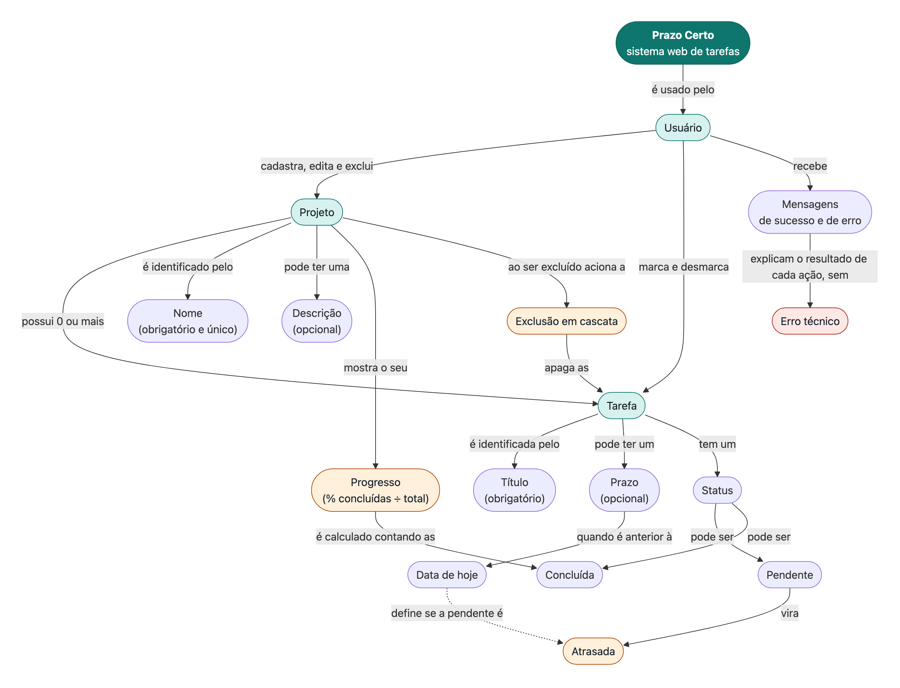
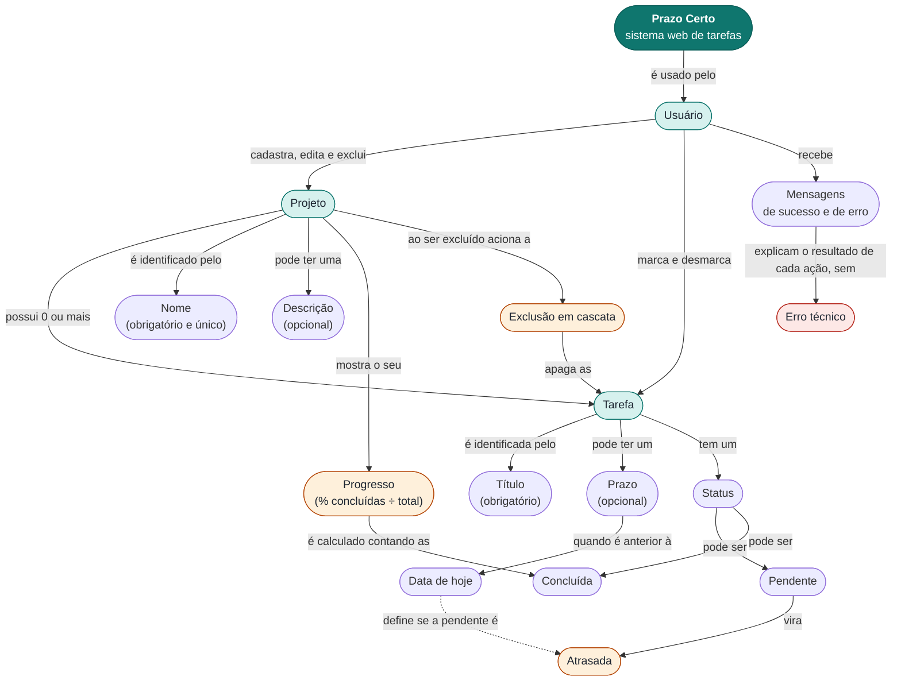
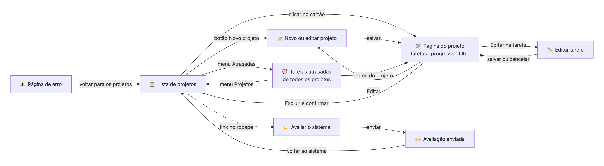
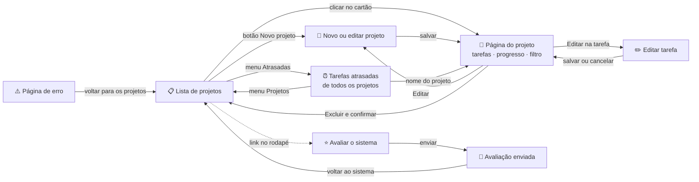

# Mapa conceitual — Prazo Certo

Num mapa conceitual, cada caixa é um **conceito** e cada seta é lida como uma frase:
**conceito → palavra de ligação → conceito**. Por exemplo: "Projeto **possui** Tarefas".

As imagens em PNG ficam em [`diagramas/`](diagramas/).

## 1. Mapa conceitual do sistema

Mostra as ideias principais do Prazo Certo e como elas se relacionam.

Código do diagrama (Mermaid)

**Como ler alguns caminhos do mapa:**
- Usuário → *cadastra* → Projeto → *possui 0 ou mais* → Tarefas.
- Tarefa → *tem um* → Status → *pode ser* → Pendente → *vira* → Atrasada, quando o prazo é anterior à data de hoje.
- Projeto → *mostra o seu* → Progresso → *é calculado contando as* → Concluídas.
- Projeto → *ao ser excluído aciona a* → Exclusão em cascata → *apaga as* → Tarefas.

## 2. Mapa de navegação (IHC)

Mostra as telas do sistema e como o usuário passa de uma para outra.

Código do diagrama (Mermaid)

Na página do projeto, **adicionar, concluir e excluir tarefas** acontece na própria tela, sem trocar de página.

### Mensagens de cada tela

| Tela | Sucesso (verde, some sozinha) | Erro (vermelho, fica até fechar) | Confirmação antes de apagar |
|---|---|---|---|
| Novo ou editar projeto | "Projeto criado com sucesso." · "Projeto atualizado com sucesso." | "Informe o nome do projeto." · "Já existe um projeto com esse nome." · limite de caracteres | — |
| Página do projeto | "Tarefa criada com sucesso." · "Tarefa marcada como concluída." / "como pendente." · "Tarefa excluída." · "Projeto e suas tarefas foram excluídos." | "Informe o título da tarefa." · "Informe um prazo válido (dia/mês/ano)." · "Sem conexão com o servidor..." | "Excluir o projeto e todas as suas tarefas?" · "Excluir a tarefa?" |
| Editar tarefa | "Tarefa atualizada com sucesso." | "Informe o título da tarefa." · "Informe um prazo válido (dia/mês/ano)." | — |
| Tarefas atrasadas | "Tarefa marcada como concluída." (e ela sai da lista) | "Sem conexão com o servidor..." | — |
| Avaliar o sistema | Página "Avaliação enviada. Muito obrigado!" | "Informe o seu nome." · "Conte o que você testou e funcionou." · "A data do teste não pode estar no futuro." · print inválido ou grande demais | — |
| Página de erro | — | "Projeto não encontrado." · "Tarefa não encontrada." · "Página não encontrada." · "Algo deu errado. Tente novamente em instantes." | — |

## 3. Princípios de IHC aplicados

Os princípios do material da disciplina e onde eles aparecem no sistema:

| Princípio | Onde aparece no Prazo Certo |
|---|---|
| **Clara** | Rótulos simples ("Nova tarefa", "Prazo (opcional)"), campo obrigatório marcado com * |
| **Consistente** | Mesmo layout, botões e cores em todas as telas; verde = sucesso, vermelho = erro/excluir, laranja = atraso |
| **Simples** | Só 2 itens no menu; o cadastro de tarefa fica na própria página do projeto |
| **Controlada pelo usuário** | Nada é apagado sem confirmação; o usuário escolhe o filtro "Todas" / "Atrasadas" |
| **Direta** | Clicar no quadradinho conclui a tarefa e a barra de progresso muda na hora |
| **Recuperável** | Tarefa concluída pode ser desmarcada; em erro de formulário, o que foi digitado não se perde |
| **Dá resposta** | Toda ação mostra uma mensagem; botão fica bloqueado enquanto salva |
| **Esteticamente agradável** | Cartões, barra de progresso, modo escuro e layout para celular |
