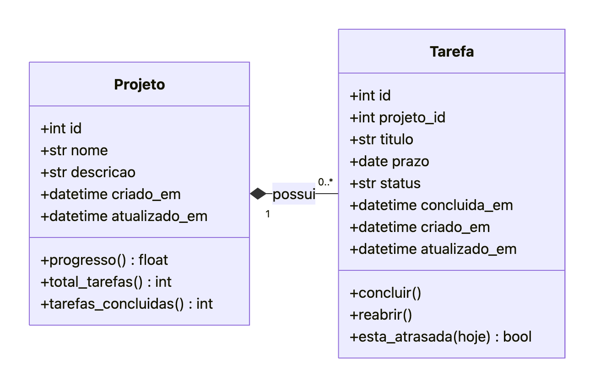
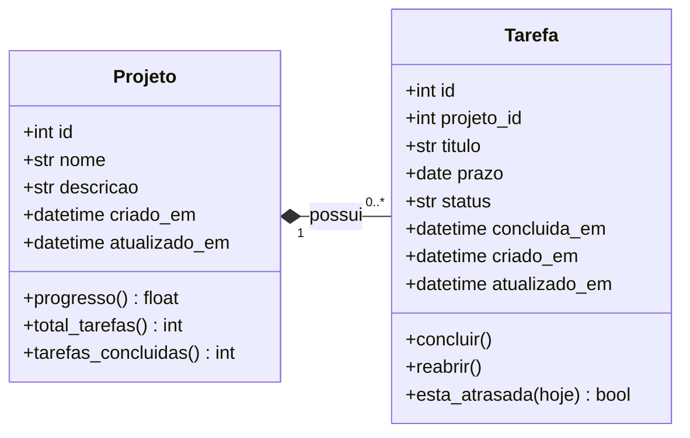
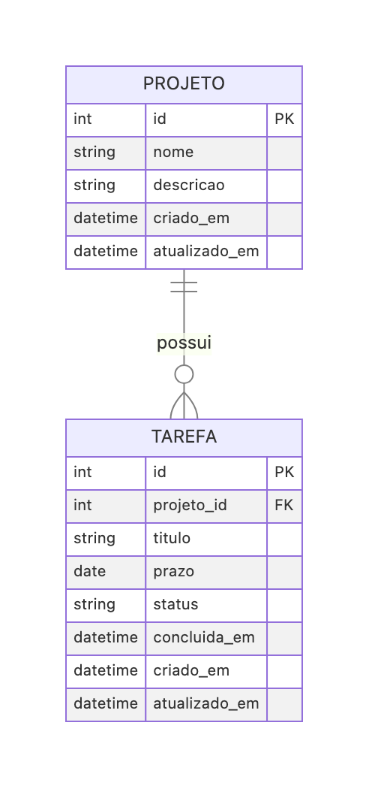
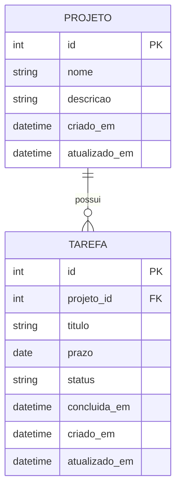

# Modelo de dados — Prazo Certo

O sistema guarda dois tipos de informação: **projetos** e as **tarefas** de cada projeto.
Um projeto tem zero ou muitas tarefas; cada tarefa pertence a exatamente um projeto
(relacionamento **um para muitos**, 1:N).

## 1. Diagrama de classes de persistência (UML)



<details>
<summary>Código do diagrama (Mermaid)</summary>



</details>

A ligação é uma **composição** (losango cheio): a tarefa não existe sem o projeto.
Por isso, excluir um projeto exclui também as suas tarefas (requisito funcional 6).

## 2. Projeto conceitual (DER)



<details>
<summary>Código do diagrama (Mermaid)</summary>



</details>

- **PROJETO** — um conjunto de trabalho que o usuário quer organizar (ex.: "TCC", "Mudança de casa").
- **TAREFA** — uma atividade que precisa ser feita dentro de um projeto (ex.: "Escrever introdução").
- **possui** — cardinalidade 1:N. Lado PROJETO: exatamente 1. Lado TAREFA: 0 ou muitas.

## 3. Projeto lógico normalizado

```
projeto (id, nome, descricao, criado_em, atualizado_em)
    PK: id
    UNIQUE: nome

tarefa (id, projeto_id, titulo, prazo, status, concluida_em, criado_em, atualizado_em)
    PK: id
    FK: projeto_id → projeto(id)  ON DELETE CASCADE
```

### Verificação das formas normais
- **1FN:** todos os atributos são atômicos (um valor só por campo) e não há grupos repetidos.
  As tarefas ficam em tabela própria em vez de uma lista dentro do projeto.
- **2FN:** as chaves primárias são simples (`id`), então não existe dependência parcial.
- **3FN:** nenhum atributo depende de outro atributo que não seja a chave.
  Por isso, **progresso** e **atrasada** não são gravados no banco: são **calculados**
  na hora a partir das tarefas. Assim eles nunca ficam desatualizados.

### Valores calculados (não armazenados)
| Valor | Regra |
|---|---|
| Progresso do projeto | `concluídas ÷ total × 100`, arredondado para inteiro. Projeto sem tarefas = **0%** |
| Tarefa atrasada | `prazo < data de hoje` **e** `status = 'pendente'`. Tarefa sem prazo nunca está atrasada. Prazo igual a hoje ainda não está atrasado |

## 4. Projeto físico

SGBD de desenvolvimento: **SQLite**. Em produção, o mesmo modelo roda em **PostgreSQL** ou
**MySQL**: a aplicação usa SQLAlchemy (ORM), e o banco é escolhido pela variável de ambiente
`DATABASE_URL`. O script completo está em [`schema.sql`](schema.sql).

| Tabela | Índice | Motivo |
|---|---|---|
| `projeto` | `uq_projeto_nome` (único) | Impedir dois projetos com o mesmo nome |
| `tarefa` | `ix_tarefa_projeto_id` | Listar rápido as tarefas de um projeto |
| `tarefa` | `ix_tarefa_status_prazo` | Filtrar rápido as tarefas atrasadas |

Diferenças entre os SGBDs:

| Item | SQLite | PostgreSQL | MySQL |
|---|---|---|---|
| Chave autoincremento | `INTEGER PRIMARY KEY AUTOINCREMENT` | `SERIAL` / `GENERATED ALWAYS AS IDENTITY` | `INT AUTO_INCREMENT` |
| Exclusão em cascata | precisa de `PRAGMA foreign_keys = ON` em cada conexão (a aplicação faz isso) | nativo | nativo (InnoDB) |
| Data e hora | `TEXT` em ISO 8601 | `DATE` / `TIMESTAMP` | `DATE` / `DATETIME` |

## 5. Regras de integridade
1. `projeto.nome` é obrigatório, sem espaços nas pontas, de 1 a 100 caracteres, e único (sem diferenciar maiúsculas e minúsculas).
2. `tarefa.titulo` é obrigatório, sem espaços nas pontas, de 1 a 150 caracteres.
3. `tarefa.status` só aceita `pendente` ou `concluida`. Valor inicial: `pendente`.
4. `tarefa.concluida_em` é preenchida quando a tarefa é concluída e apagada quando ela é reaberta.
5. Toda tarefa precisa de um projeto existente (`projeto_id` obrigatório, com chave estrangeira).
6. Excluir um projeto exclui as suas tarefas (`ON DELETE CASCADE` no banco e `cascade="all, delete-orphan"` no ORM).
