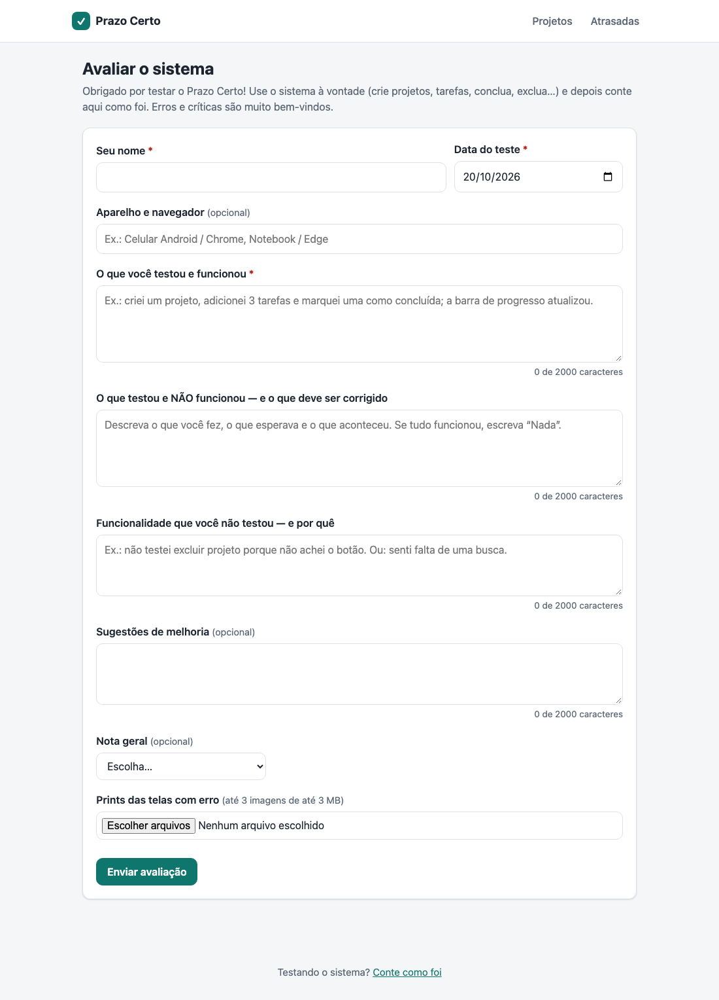
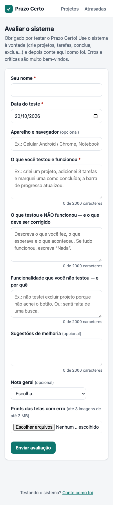

# Situação 3 — Testes, validação com colegas e laudo de qualidade

| Arquivo | Conteúdo |
|---|---|
| [verificacao-e-validacao.md](verificacao-e-validacao.md) | Como o sistema foi verificado e validado (Modelo V), com os resultados |
| [roteiro-de-testes.md](roteiro-de-testes.md) | Casos de teste passo a passo, com o resultado esperado e o obtido |
| [registro-dos-testes.md](registro-dos-testes.md) | As 5 avaliações dos colegas (vira o PDF de entrega) |
| [laudo-de-qualidade.md](laudo-de-qualidade.md) | Erros encontrados, correções e evidências |
| [imagens/](imagens/) | Prints do formulário de avaliação |

## Formulário de avaliação

A disciplina pede um formulário para os colegas descreverem bugs, sugestões e enviarem prints.
Ele foi feito **dentro do próprio sistema**, então o colega testa e avalia no mesmo lugar:

- **Formulário:** https://prazo-certo.onrender.com/avaliacao (também no rodapé de todas as páginas)
- **Campos:** nome, data do teste, aparelho e navegador, o que testou e funcionou, o que não funcionou
  (e o que corrigir), funcionalidade não testada (e por quê), sugestões, nota de 1 a 5 e até 3 prints.
  Os 5 primeiros são os itens mínimos exigidos pela disciplina.
- **Resultados:** `https://prazo-certo.onrender.com/avaliacoes?chave=<CHAVE>` (também em JSON em `/avaliacoes.json?chave=<CHAVE>`).
  A chave é a variável `AVALIACOES_CHAVE`, gerada pelo Render (painel do Render → serviço *prazo-certo* → *Environment*).
  Sem a chave certa a página responde "Página não encontrada", então as avaliações não ficam públicas.

| Computador | Celular |
|---|---|
|  |  |

## Passo a passo da Situação 3

2. Acompanhar as respostas em `/avaliacoes?chave=...`.
3. Passar as 5 avaliações para o [registro-dos-testes.md](registro-dos-testes.md) e gerar o PDF.
4. Classificar cada problema no [laudo de qualidade](laudo-de-qualidade.md), corrigir o que for pertinente
